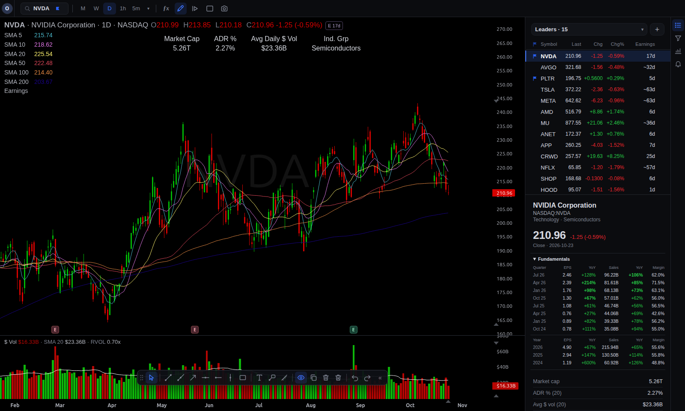
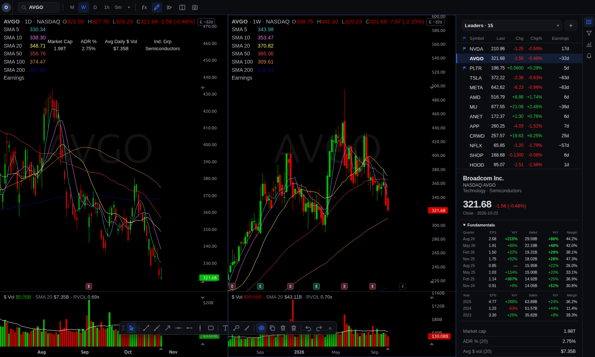
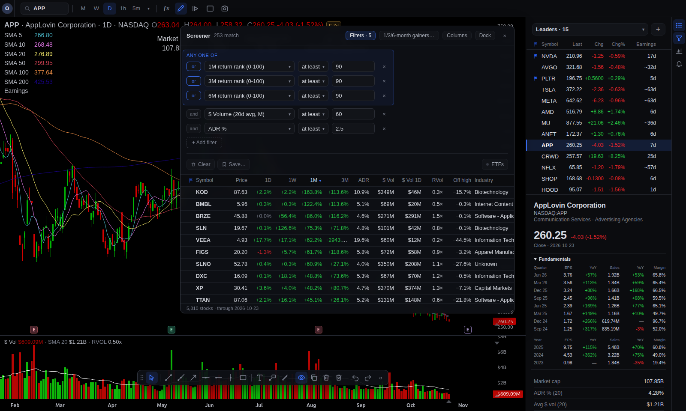
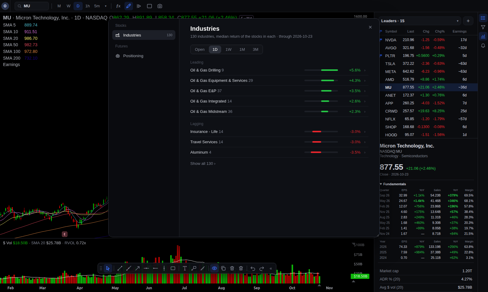
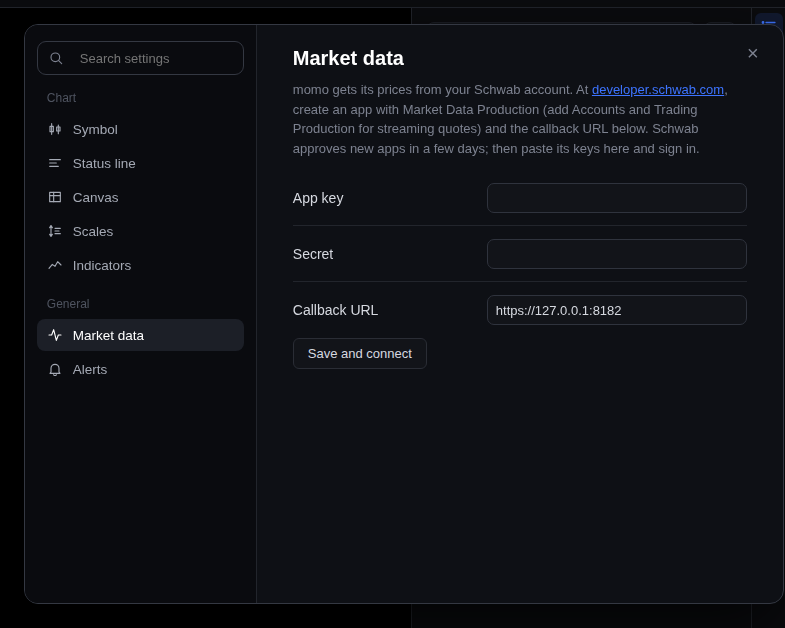

# momo charts

Stock charts, watchlists, a screener and price alerts that run on your own computer, with
prices and about 20 years of daily history from your own Charles Schwab account.

I trade momentum swings, and my fingers already know TradingView's and TC2000's hotkeys, so
momo uses the same ones. It also puts the things I check on every chart right next to it: ADR,
dollar volume, how far the stock is from its highs, and when it reports next.

**Site and live demo: [alx-kap.github.io/momo-charts](https://alx-kap.github.io/momo-charts/)**

Apache 2.0. Python (FastAPI) on the server, plain JavaScript in the browser, no build step.
The charts are drawn by a small engine written just for momo, so there's no charting library or
other third-party code in the browser.



## Why I built it

- **I wanted my data on my own disk.** There's no subscription and no account with me. momo
  keeps its own database of daily bars and only talks to Schwab for prices and to free public
  sources for the rest: Nasdaq for symbols and earnings dates, SEC EDGAR for fundamentals,
  the CFTC for futures positioning.
- **I wanted it fast from the keyboard.** Start typing a ticker and press Enter to open it.
  Type `5` or `1W` to change the timeframe, `⌥T` for a trend line, `Ctrl+K` for everything
  else. `?` lists every shortcut.
- **I wanted the numbers next to the chart.** ADR %, dollar volume, relative volume, distance
  from highs, days to earnings, and EPS and sales growth by quarter show up beside every chart
  and as columns in every list.
- **The data is already paid for.** If you have a Schwab brokerage account, the market data
  from its Trader API doesn't cost anything extra.

## The chart engine

momo draws its charts with its own engine, in
[`src/momo_scan/web/static/js/engine/`](src/momo_scan/web/static/js/engine/). It's five plain
ES modules, under 70 KB, painting on canvas: candles, OHLC bars, lines and histograms in
stacked panes, the price and time axes, the crosshair, panning, zooming and pinch. Nothing to
install and nothing to build.

It started out on TradingView's Lightweight Charts, which is a good library, but drawings,
Bar Replay and earnings markers were layers that had to be kept in step with someone else's
chart, and I wanted control over how things look. On 10,000 daily bars the new engine gets a
chart on screen about twice as fast and pans about 30% faster. Candles are snapped to device
pixels so they stay crisp at any zoom, and the axis labels don't jump around while you pan.

## Features

### Charts

- Daily, weekly and monthly charts, and intraday from 1 minute to 1 hour with the pre- and
  post-market shaded.
- Split view: two charts side by side, each with its own symbol and timeframe. Link the
  symbol and crosshair or keep them apart.
- Indicators: simple and exponential moving averages, VWAP, Bollinger Bands, Keltner
  Channels, RSI, MACD, ATR, ADR %, a relative strength line against SPY and high-volume
  closes. Earnings dates sit along the bottom of the chart.
- Drawing tools: trend lines, rays, horizontal and vertical lines, rectangles, arrows, text
  and a measure tool. Drawings are saved per symbol.
- Bar Replay, to step a chart forward one bar at a time from any day in the past.
- With live prices on, today's bar moves as the price does, and there's a tag for the pre-
  and post-market price.
- Settings for colours, log and inverted scales and the status line, and a button that copies
  a picture of the chart.



### Watchlists

- As many lists as you like, with live prices, change, volume, ADR, days to earnings and
  fundamentals. Sort, resize and reorder the columns.
- A Flagged list built in: `⇧F` flags whatever's on the chart. `↓` and `↑` step through a
  list.
- A details panel for the stock on screen: price, 52-week range, returns from a week to a
  year, and eight quarters plus three years of EPS and sales with year-over-year growth.

### Screener

Filter every US-listed stock on your own rules: returns and return ranks from 1 day to 6
months, ADR, dollar and relative volume, where price sits against its moving averages and
whether they're stacked, distance from highs and lows, new highs, earnings timing, and EPS and
sales growth. There are starter screens (breakouts on volume, pullbacks to the 20-day, top
1/3/6-month gainers, growth leaders and a few more), and you can save your own. During market
hours a live mode re-runs the screen on today's prices. The results work like a watchlist:
click one to chart it, use the arrow keys to step through.



### Market

- **Industries:** which industries are leading and lagging today, this week, this month and
  over three months. Click one to see its stocks.
- **Positioning:** where commercial hedgers, large speculators (hedge funds and CTAs) and
  small traders stand in each futures market, from the CFTC's weekly Commitments of Traders
  report.



### Price alerts

Press `⌥A` on a chart to set an alert, and drag its line to move it. The server checks alerts
against live quotes, so you hear them in any open tab, even when that stock isn't on screen.

## Quick start

You'll need Python 3.12, [uv](https://docs.astral.sh/uv/) and a Schwab brokerage account.

```bash
git clone https://github.com/alx-kap/momo-charts.git
cd momo-charts
uv sync
uv run momo serve
```

Then open http://127.0.0.1:8790. The first time, momo opens a Market data window that asks
for your Schwab app's keys and then has you sign in.

### Setting up Schwab (once)

1. Sign in at [developer.schwab.com](https://developer.schwab.com) with your normal Schwab
   login and create an app with **Market Data Production**. If you also add **Accounts and
   Trading Production**, quotes stream instead of being polled. Set the callback URL to
   `https://127.0.0.1:8182` and the order limit to 0. momo never places orders.
2. Wait for Schwab to approve it. That usually takes a few days. The app's page will then
   show an **App Key** and a **Secret**.
3. Paste both into momo's Market data window and click **Save and connect**.
4. Click **Sign in to Schwab…** and approve. Your browser ends up on a page that fails to
   load; copy its address and paste it back into momo, since it carries the sign-in code.
   The sign-in lasts 7 days, and the live badge in the top bar warns you a day before it runs
   out.



## Where the data comes from

Everything is kept in `data/` on your computer.

- **Daily bars (`bars.db`):** the list of US stocks comes from Nasdaq's public symbol
  directory, and sectors, industries and market caps from Nasdaq's screener. The history,
  about 20 years per symbol and split-adjusted, comes from Schwab, starting with the biggest
  companies. Filling all of it takes about an hour, but any chart you open is filled right
  away. After each close momo adds the day's bar and refetches anything that split, and on
  Saturdays it re-checks the last two weeks. Plan on 1 to 3 GB.
- **Intraday bars (`intraday.db`):** fetched from Schwab when you open an intraday chart, then
  kept up to date from the live feed.
- **Your settings (`momo.db`):** watchlists, drawings, chart settings, saved screens and
  alerts.
- **Your Schwab keys and sign-in (`live.toml`, `schwab_tokens.json`):** only your user account
  can read them.

Two optional extras, one command each:

- **Earnings dates and fundamentals:** `uv run momo fundamentals-update`, from SEC EDGAR and
  Nasdaq. The SEC wants a contact address, so set `user_agent = "momo you@example.com"` under
  `[fundamentals]` in `config/momo.toml` first.
- **Futures positioning:** `uv run momo cot-update`, from the CFTC's weekly report.

## Using another data provider

Daily bars are read from the tables `src/momo_scan/bars.py` creates, through
`src/momo_scan/providers/sqlite.py`. Live prices come from a provider in `src/momo_scan/live/`
(the interface is in `live/base.py`). To use a different vendor, write a live provider with
`daily()` for history and `sweep()` for quotes, the way `live/schwab.py` does, or fill
`bars.db` yourself.

## FAQ

**Can it replace TradingView?** For US stocks, maybe. It does charts, watchlists, screening
and alerts on daily and intraday bars, on your own machine and your own data. It doesn't have
a scripting language or anything social, and it only covers US stocks and ETFs.

**Does it trade?** No. It only reads market data, and the Schwab app you create for it has an
order limit of 0.

**Do I need Schwab?** For now, yes. Schwab is where the prices and history come from. Another
provider can be added (see above).

**Where does it run?** Anywhere Python 3.12 does. I develop it on Linux and use it from a
browser on a Mac. The server only listens on your own computer (127.0.0.1) unless you tell it
otherwise.

**Is it affiliated with TradingView or Schwab?** No. You reach Schwab's data through your own
developer app.

## Development

```bash
uv run --extra dev pytest
uv run --extra dev ruff check src tests tools
```

The browser code is plain ES modules in `src/momo_scan/web/static/js/`, so there's nothing to
build. momo charts is the charting half of a trading workbench I use, and I publish it as it
changes.

## License

Apache License 2.0. See [LICENSE](LICENSE) and [NOTICE](NOTICE). All of the code here,
including the chart engine, is momo's own.
